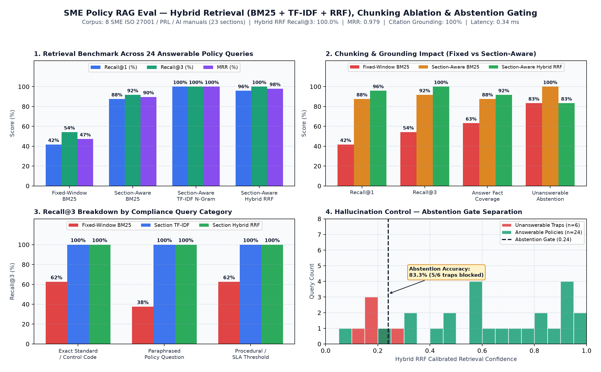

# SME Policy RAG Eval

**Grounded compliance Q&A, hybrid retrieval (`BM25 + Word/Char TF-IDF + Reciprocal Rank Fusion`), abstention gating, structured Pydantic outputs, and an offline-reproducible RAG evaluation harness for SME cybersecurity (ISO 27001), AI governance, and workplace safety (PRL) manuals.**

Small and mid-size organizations maintain critical compliance manuals (ISO 27001 access control, GDPR 72-hour breach reporting, BitLocker/TPM endpoint hardening, chemical lab PPE, workplace ergonomics, and AI acceptable use). Naive RAG prototypes fail silently in production: fixed-window chunking splits numeric SLAs mid-clause, pure lexical search struggles with paraphrased employee questions, and uncalibrated pipelines hallucinate answers to out-of-scope questions. **SME Policy RAG Eval** benchmarks chunking and hybrid retrieval strategies quantitatively across 30 labeled test cases (24 answerable policy queries + 6 unanswerable abstention traps), enforces an explicit `INSUFFICIENT_EVIDENCE` abstention gate, extracts structured compliance obligations (`SLAs`, `standards`, `responsible roles`), and runs 100% offline with an optional local **Ollama** adapter.



---

## Quickstart (Run Locally in 60 Seconds — No API Key Required)

```bash
git clone https://github.com/xx636xx/sme-policy-rag-eval.git
cd sme-policy-rag-eval

python -m venv .venv
# Windows (PowerShell): .venv\Scripts\Activate.ps1
# macOS / Linux:        source .venv/bin/activate

pip install -e ".[dev]"

# 1. Run the 4-pipeline RAG evaluation benchmark and regenerate the overview dashboard
python -m sme_policy_rag.cli eval

# 2. Ask a grounded compliance question (returns typed Pydantic JSON with citations & obligations)
python -m sme_policy_rag.cli ask "Under GDPR Article 33, who notifies the AEPD and within what deadline?"

# 3. Test out-of-scope abstention (refuses to speculate on topics outside the manuals)
python -m sme_policy_rag.cli ask "What is the maximum reimbursement limit for international business-class flights?"

# 4. Run the automated test suite
python -m pytest -v
```

Optional local LLM synthesis with **Ollama** (when running locally on `http://localhost:11434`):

```bash
python -m sme_policy_rag.cli ask "How close must emergency eye-wash stations be?" --ollama-model qwen2.5:7b
```

---

## Verified Benchmark Results (8 Manuals, 23 Policy Sections, 30 Labeled Eval Cases)

| Pipeline | Recall@1 | Recall@3 | MRR | Answer Fact Coverage | Citation Grounding | Unanswerable Abstention | False Abstention | Mean Latency |
| :--- | :---: | :---: | :---: | :---: | :---: | :---: | :---: | :---: |
| **Fixed-Window + BM25** | 41.7% | 54.2% | 0.472 | 63.2% | 100.0% | 83.3% (5/6) | 4.2% | 0.07 ms |
| **Section-Aware + BM25** | 87.5% | 91.7% | 0.896 | 87.5% | 100.0% | 100.0% (6/6) | 8.3% | 0.07 ms |
| **Section-Aware + TF-IDF N-Gram** | 100.0% | 100.0% | 1.000 | 79.2% | 100.0% | 100.0% (6/6) | 20.8% | 0.28 ms |
| **Section-Aware + Hybrid RRF** | **95.8%** | **100.0%** | **0.979** | **91.7%** | **100.0%** | **83.3% (5/6)** | **8.3%** | **0.34 ms** |

Key empirical takeaways:
- **Chunking beats blind model tuning:** Replacing 240-char fixed windows with Markdown section-aware chunking lifted BM25 Recall@3 from **54.2% → 91.7%** (+37.5 pp) and Answer Fact Coverage from **63.2% → 87.5%**.
- **Hybrid RRF delivers the best end-to-end balance:** Pure TF-IDF achieved high ranking scores but suffered a **20.8% false-abstention rate** due to compressed cosine scores on short queries. Fusing BM25 + Word/Char TF-IDF via Reciprocal Rank Fusion achieved **100% Recall@3 across all 3 query categories** (`exact_code`, `paraphrased_policy`, `procedural_threshold`), the highest **Answer Fact Coverage (91.7%)**, and **83.3% abstention accuracy** on out-of-scope traps.

---

## Sample Structured Output (`sme_policy_rag.cli ask`)

```json
{
  "query": "Under GDPR Article 33, who notifies the AEPD and within what deadline?",
  "status": "ANSWERED",
  "confidence": 0.6637,
  "answer": "[POL-SEC-02-SEC-02] Cyber Incident Response and GDPR Breach Notification — GDPR Personal Data Breach Reporting (72-Hour Rule): Under GDPR Article 33 and ISO 27001 control A.5.24, any confirmed breach involving personal data must be notified to the Data Protection Authority (AEPD) within 72 hours of awareness by the Data Protection Officer (DPO)...",
  "obligations": {
    "sla_or_threshold": ["72 hours"],
    "referenced_standards": ["GDPR", "GDPR Article 33", "ISO 27001 control A.5.24"],
    "responsible_roles": ["Data Protection Officer (DPO)"]
  },
  "grounding_score": 1.0,
  "latency_ms": 1.12,
  "provider": "extractive-grounded"
}
```

---

## Project Structure

```text
sme-policy-rag-eval/
├── assets/
│   └── rag_eval_overview.png        # 4-panel verified evaluation dashboard
├── src/sme_policy_rag/
│   ├── corpus.py                    # 8 SME ISO 27001 / PRL / AI manuals + 30 eval cases
│   ├── chunking.py                  # Fixed-window vs section-aware Markdown chunkers
│   ├── retrieval.py                 # Okapi BM25, Word+Char TF-IDF, and Hybrid RRF
│   ├── synthesizer.py               # Grounded synthesizer, obligation extractor, abstention gate, Ollama adapter
│   ├── evaluator.py                 # Automated Recall@k, MRR, grounding & abstention harness
│   ├── plotting.py                  # Matplotlib 4-panel dashboard renderer
│   ├── schemas.py                   # Pydantic v2 contracts
│   └── cli.py                       # `eval` and `ask` CLI commands
└── tests/
    └── test_rag_eval.py             # Chunking, abstention, extraction & benchmark tests
```

## Author

**Alejandro Montejo de Luna**

## License

MIT — see [LICENSE](LICENSE).
